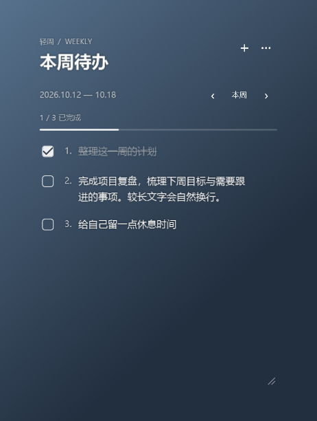

# 轻周待办 · Light Week Todo

适用于 Windows 11 的轻量桌面周待办挂件。透明背景、白色文字，按周保存清单，不需要账号或联网。



## 下载与安装

**[下载 Windows 安装包 v1.0.5](releases/v1.0.5/LightWeekTodo-Setup-1.0.5.exe?raw=true)**

双击安装包，选择安装文件夹后安装。可选桌面快捷方式和开机自启。更新时运行新版安装包，保留原有清单。

安装包使用 Windows 自带的 .NET Framework 4.x，无需单独安装开发环境。当前安装包未做代码数字签名。

## 功能

- 透明、无边框桌面挂件，白色文字；背景浓度可调。
- 整周清单，周一开始；切换上周、下周，历史记录独立保存。
- 勾选完成，自动编号；支持编辑、删除和上下调整顺序。
- 右上角 `+` 弹窗添加，`···` 打开设置。
- 拖动标题区移动，拖动右下角调整大小；自动记住位置和大小。
- 设置中的“锁定位置”防止误拖动，重启后保留锁定状态。
- 可选始终置顶、开机自启，支持托盘隐藏、恢复和退出。
- 本机自动保存、保留上一份备份，并可手动导出全部清单。

## 使用

1. 点击右上角 `+` 输入待办，按 Enter 或点击“添加”。
2. 点击事项前的方框标记完成。双击文字编辑，右键可移动或删除。
3. 使用 `‹`、`›` 切换周，点击“本周”返回当前周。
4. 拖动顶部标题区放到想要的位置，再点 `··· → 锁定位置`；取消勾选可恢复拖动。
5. 右键 Windows 托盘图标可隐藏或退出，双击托盘图标重新显示挂件。

完整说明见 [使用说明](src/README.txt)。

## 数据与备份

清单和设置保存在 `%APPDATA%\LightWeekTodo\data.json`。文件夹内的 `data.json.bak` 为上次保存的备份。

设置菜单中可导出全部清单。卸载会保留清单数据。仓库只包含程序源码和演示预览，不包含用户待办数据。

## 从源码构建

在 Windows PowerShell 中进入仓库根目录：

```powershell
powershell -ExecutionPolicy Bypass -File .\build.ps1
```

生成文件：

- `build\LightWeekTodo.exe`：应用程序。
- `build\LightWeekTodo-Setup.exe`：安装程序。

在有桌面会话的 Windows 环境中，可运行包含窗口和托盘交互的隔离自检：

```powershell
powershell -ExecutionPolicy Bypass -File .\build.ps1 -Test
```

自检使用 `test-output` 中的临时数据，不会安装应用或改动个人清单。GitHub Actions 工作流编译应用并归档安装包；远程工作流不运行需要桌面会话的交互自检。

更多实现与验证边界见 [开发说明](docs/DEVELOPMENT.md)。

## 版本

当前版本：**1.0.5**。详见 [更新记录](CHANGELOG.md)。
